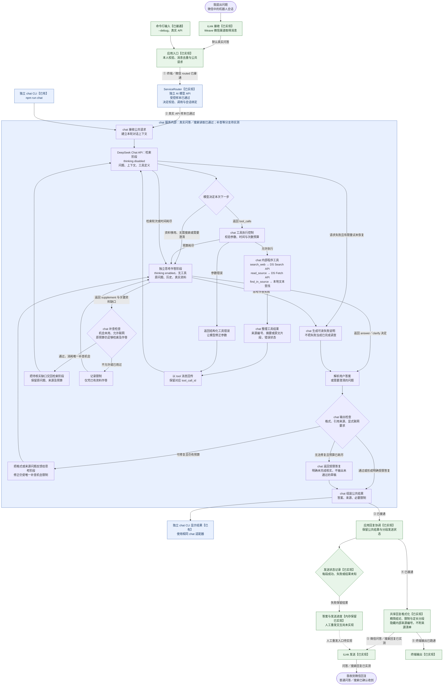
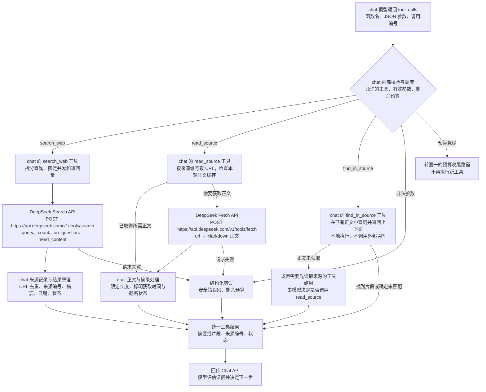

# Weave chat 服务方案讨论

> 文档状态核对：2026-10-22。前半说明当前 chat 设计；“调研依据与可借鉴设计”起保留原调研阶段的历史讨论。

更新日期：2026-10-22。本文只维护 `chat` 服务内部的聊天、问答与搜索整合方案，保留原文件名作为讨论入口；后半保留 Codex／DeepSeek 的调研比较。上层 AI 服务路由与并列后端的边界见 [整体架构的已确认分工](架构草案.md)。

**已认可的核心方向：上层服务路由通过自己的 AI API 调用理解自然语言并选择服务；选中 chat 后，同一 DeepSeek 模型先关闭思考进行检索决策与工具循环，再开启思考根据实际资料作答；思考发现关键缺口时，最多返回检索阶段补查一次。** 无需搜索的问题和澄清也由思考作答阶段生成用户回复。路由的意图判断与 chat 的搜索判断分别属于不同模块；chat 内部不另外增加搜索分类模型。

下面的流程图区分当前实现与尚未接入的能力。微信与终端默认经通用应用／独立 AI 路由调用真实 chat，独立 chat CLI 也可使用；实际模块与默认预算见 [chat L2](../src/chat/L2.md)，运行入口见 [README](../README.md#chat-本机问答与搜索)。已通过的问答、追问、搜索读取与手机收发样本，以及补查、长回复等尚未全面覆盖的边界和已知问题，统一见 [项目交接](交接文档.md#4-当前验证与下一步)。阶段范围见 [首版方案](首版方案.md)。

## 模块归属

| 层次 | 本轮已确认的职责 | 与 chat 的关系 |
|---|---|---|
| 后端服务路由 | 用 AI API 理解自然语言，选择 chat／DSH／远端 Codex 等服务，管理服务调用 | chat 的调用方；不参与搜索、网页阅读或信息整合 |
| chat 服务 | 聊天与上下文、直接回答／搜索判断、Search／Fetch 程序工具、阅读与查找、补查循环、证据核对与答案组装 | 本文全部内部搜索架构的归属模块 |
| DSH／SSH 远端 Codex | 各自完成文件、开发或远端执行任务 | chat 的平级服务，不是 chat 工具或子模块 |
| 共享协作层 | 微信收发、应用入口的访问与去重、通用回复呈现和发送状态 | chat 之外；只通过公共请求与结果衔接 |

路由 AI 和 chat AI 可以使用同一供应商或同一模型，但业务模块、提示词、上下文和结果契约分别管理，不通过调用 chat 服务完成路由。图一保留微信端到端上下文，`chat 服务内部` 子图才是本文描述的模块边界。

## 1. 从我提出问题到我收到回答

图中“程序”指 Weave 自己运行的代码；搜索工具与相应模型适配全部归 chat 服务内部。外层路由 API 已装配共享 DeepSeek 客户端，模型与密钥配置独立，真实受控样本已通过。chat 使用的 Chat、Search、Fetch 分别是外部 API；工具名称是 chat 提供给自身模型调用的程序函数。

**2026-10-22 真实链路已验证：** ①～⑤ 对应 [整体架构的连接位置](架构草案.md#当前连接缺口)。绿色为已有应用能力；蓝色为真实 API 受控样本通过的链路。实线表示已有连接，虚线待装配或实施。微信已接通真实 API 并完成普通问答／搜索回复手机验收，默认启动与终端均只使用真实服务，独立 chat CLI 也可单独调用。模拟实现与模拟 HTTP／模型测试已删除；补查、异常与长回复仍需各自验收。



阅读要点：

- **两层 AI 决策分开。** 外层路由决定调用哪个后端；图中的 DeepSeek Chat API 只负责已选中 chat 后的服务内部处理，不决定转交 DSH 或远端 Codex。
- **直接回答也经过思考阶段。** 检索阶段判断无需外部资料后，跳过 Search／Fetch，由思考作答阶段生成回复。
- **搜索阶段可以循环，思考阶段可请求一次补查。** 每次工具执行后再次调用关闭思考的 Chat；模型继续搜、读原文、查找片段，或返回结束决定。思考阶段不直接执行工具，只提出待核实的关键缺口；程序检查后最多交回检索阶段一次，再重新合并资料作答。所有阶段共用原预算，补查和修正都不能重置预算。
- **同一模型不等于一次 API 请求。** 直接回答通常需要检索决策与思考作答两次 Chat 请求；搜索可能需要更多检索轮次。
- **澄清也是有效回复。** 缺少地点、时间等关键信息时，模型可以先向用户提问，不必盲目搜索。
- **接口回执不等于真实送达。** 现有渠道的 `accepted`／`submitted` 分别表示接口明确受理／提交完成；实际在手机看到回答是独立事实。失败或未知时不能盲目重发，避免重复消息；具体恢复交互待定。

## 2. 程序工具怎样调用外部服务

下图全部属于 chat 服务内部；上层服务路由只等待公共结果，不接触这些工具及来源记录。



### chat 使用的外部 API 清单

| 服务／API | 谁发起 | 作用与返回 | 本方案的边界 |
|---|---|---|---|
| DeepSeek Chat：`POST /chat/completions` | chat 内部模型适配器 | 检索阶段返回工具调用或结构化决定；思考阶段返回最终答案或关键资料补查决定 | 同一模型分阶段调用；承担本服务的检索决策和答案分析，不承担跨服务路由 |
| DeepSeek Search：`POST /v1/tools/search` | `search_web` 经搜索适配器 | 返回网页来源、摘要和可选正文等结构化结果 | 不是完整聊天回答服务；查询拆分、合并与回传由程序负责 |
| DeepSeek Fetch：`POST /v1/tools/fetch` | `read_source` 经抓取适配器 | 返回指定网页的 Markdown 正文 | 来源不可访问或无正文时如实返回失败，不假装已读取 |

DeepSeek 三种 API 可使用同一套 API Key，密钥只由适配器与配置处理，不进入模型可见的工具结果。此处采用普通 Chat 函数调用加独立 Search／Fetch，便于控制流程；不依赖 Pro Responses 或 Messages 的托管搜索路径。接口依据见文末 [D1–D3]。

腾讯 iLink 及其登录、收发和状态归共享微信渠道，见[渠道地图](../src/weixin_ilink/L2.md)；路由 AI API 归上层路由模块，不计入 chat 的内部调用清单。

### 程序工具与内部职责清单

| 程序工具／职责 | 输入 | 输出／负责的事 | 是否额外调用模型 |
|---|---|---|---|
| `search_web(queries)` | 模型生成的查询列表 | 调用 Search，去重并登记来源，回传相关摘要与来源 ID | 工具本身不调用 Chat |
| `read_source(source_id, offset?)` | 已登记来源 ID 与可选读取偏移 | 复用本轮正文缓存，或调用 Fetch；按偏移返回正文片段与状态 | 否 |
| `find_in_source(source_id, pattern)` | 来源 ID 与查找词 | 在已有文本中确定性查找，返回带上下文的片段；未匹配也明确报告 | 否 |
| 工具循环控制 | 模型返回的调用及本轮状态 | 校验、执行、有限重试、预算累计与取消；工具结果回传后才继续 Chat | 负责安排 Chat 轮次，本身不是另一个模型 |
| 来源与证据记录 | Search／Fetch 的真实返回 | 内存保存 ID、URL、标题、时间、摘要、正文、截断和获取状态 | 否 |
| 补查控制 | 思考模型提出的资料缺口 | 检查唯一机会、联网与原预算；只把缺口交回检索，之后合并实际资料 | 复用非思考检索与思考作答调用，不增加第三个模型 |
| 输出检查 | 思考作答草稿、来源记录、用户显式要求 | 检查结构、引用 ID、链接归属及要求联网时是否实际获得资料；把可修缺口回传 | 规则检查本身不调用模型；修正仍开启思考，不再提供工具 |
| chat 结果组装 | 已定稿的答案、来源与限制 | 输出公共服务结果；微信分段与发送恢复由外层处理 | 否 |

上述三个工具已在 [research.ts](../src/chat/research.ts) 中实现，由同一 Research 实例管理来源和预算。用户文本中的有效网页 URL 会先登记为未读来源，再由模型决定是否读取；登记本身不等于取得证据。模型不能凭空创建来源 ID，查找工具只处理本轮已读取的正文缓存。

## 3. chat 内部的直接回答／搜索决策

### 首次调用

chat 程序向关闭思考的 Chat API 发送：原问题、必要会话上下文、检索约束、可用工具定义及本轮剩余预算。由模型决定调用工具，或返回 `answer`／`clarify` 的结构化决定；此阶段不撰写用户答案。chat 内不另设搜索分类模型。这与调用 chat 之前、由独立服务路由完成的 AI 意图识别是两个步骤。

模型指引重点：

- 翻译、改写、纯文本分析，或已有上下文足够的问题，返回无需搜索、进入作答的决定。
- 最新版本、实时价格、当地规则、用户明确要求查网／给来源等需要外部证据的问题，应调用搜索或读取用户提供的来源。
- 不清楚决定答案的关键条件时标明缺少什么，由思考作答阶段提问；不能把记忆里的不确定信息当作已联网核实。
- 有工具调用时，这一轮的内容不是最终答案；程序先执行全部需要配对的调用并回传结果。
- 只引用本轮实际取得摘要或正文的来源；历史来源元数据可帮助定位 URL，但本轮重新获取前不算新证据，不能把没有读取的页面说成已读。

未传 `network` 时使用 `auto`，由现有检索模型结合真实意图、上下文、时效性及事实不确定性决定工具使用，程序不按自然语言关键词改写策略。模型区分操作要求与引用／翻译／改写对象；auto 下明确要求不搜索时，检索不搜索／抓取，作答不请求补查，资料不足则说明限制或澄清。调用方显式传 `off` 时，程序移除并禁止本轮联网工具；这不关闭 Chat API 本身的网络请求。显式 `required` 仍要求本轮实际外部证据，缺关键条件时可澄清，不能完成时明确说明。外层服务路由只传递参数、保留澄清期间的既有约束，不从文本生成开关；各入口见 [README](../README.md#chat-本机问答与搜索)。

### 工具回传与停止

检索阶段保存模型原始工具调用消息，再按调用编号追加工具结果；多工具调用逐个配对。此阶段关闭思考。

工具结果继续交给检索阶段，提供来源状态和剩余预算。检索停止后，程序重新构造思考作答的输入：原问题、有限问答历史、来源元数据、实际取得的摘要／正文片段／查找结果及错误。前一阶段的自然语言草稿和工具调用历史不带入作答。

作答阶段开启思考且不提供工具，先判断资料是否足够。资料够用时返回包含用户回复的 answer 决定；关键事实缺失且系统允许时返回 supplement 决定，仅说明待核实的缺口。程序最多交回检索阶段一次，由关闭思考的模型决定查询与阅读；随后重新构造包含两次真实资料的作答上下文。补查决定和内部思考不作为证据，不进入用户答案或后续问答历史。内部协议、长度限制与实际执行边界以 [chat L2](../src/chat/L2.md) 为准。

补查沿用原总时间、检索截止时间、模型和工具预算，为最后思考作答保留时间和调用次数。禁止联网、机会已用或预算不足时不执行；失败、空结果或仍缺资料时在回复中说明。正常公共结果保留结论、支撑关键判断的来源及必要的不确定性；用户展示只保留正文和限制，默认隐藏内部来源编号且不罗列出处，明确索要时再给相关链接。缺用户条件时，作答模型返回结构化 clarify 决定，程序校验非空和 300 字符上限，不按提问措辞或问号判断；普通 answer 仍受 required 外部证据要求约束。作答检查修正仍开启思考，不能重置补查机会；无法形成有效答复时由程序输出可读说明，不回退到检索草稿。用户取消时不再发起新模型调用。

来源编号与 URL 检查只能证明引用来自实际工具结果；“证据是否支持结论”由模型对照原文判断，重要样本再由人工核验，不宣称程序能够完全自动证明正确性。

### 当前状态与后续校准

chat 已将本服务问题、历史、正文缓存、证据和结果保存在有界内存，重启清空；正文仅在当前轮保留，后续轮只保留有限问答与来源元数据。路由上下文与服务绑定归服务路由，不能直接复用 chat 完整历史；渠道凭据和游标归渠道，出站发送状态归外层回复协调。本阶段不增加聊天内容落盘或 SQLite。

工具次数、来源数量、正文长度、会话期限、模型调用与输出／时间预算已有默认值，来源检查修正次数和收尾预留也已实现；统一见 [chat L2](../src/chat/L2.md)，不在本讨论文档重复维护数值。下一步需要：

- 用更广泛真实样本校准两阶段预算、思考耗时、工具选择和唯一一次补查的效果。
- 优化作答资料去重与裁剪，避免检索尚在预算内、最终作答上下文却超限。
- 完善多轮指代与会话控制；独立 chat CLI 已有清空入口，微信与路由终端尚无清空交互。
- 验证并优化现有微信定长分段，设计部分发送失败／未知回执的人工恢复，以及内存答案失效后的反馈。
- 设计微信中的取消指令和必要进度提示；现有终端 Ctrl+C 和内部取消信号不等于微信已具备任务控制入口。

验收时至少覆盖：不需搜索的直接回复、一次搜索后回答、读取正文、多轮补搜、无结果、工具超时、模型调用失败、预算耗尽、用户取消、重复入站消息，以及答案完成后发送失败不重跑问答。真实 API 返回、接口受理发送和手机实际收到分开验收。

---

## 调研依据与可借鉴设计（历史讨论）

以下至文末保留原调研阶段的设计推导与资料来源。其中“候选”“拟增加”“未调用真实 API”等是当时状态，不作为当前待办或验证结论。当前已实现的工具、证据管理与补查以上文及 chat L2 为准；当前验证以项目交接为准。本轮文档整理没有重新联网核验这些历史外部资料。

DeepSeek 侧依据[前次源码调研](DeepSeek搜索链路调研_2026-10-20.md)；Codex 侧依据此前读取的 OpenAI 官方文档、公开客户端协议和示例，没有逐行审计 Codex 源码。以下为本方案的设计依据，候选细节仍可调整。

## 设计比较结论

优先组合“DS 模型与检索服务 + 可控制的工具循环 + 来源记录 + 验证反馈”，不必为搜索问答直接嵌入整个 Codex。

两套 Harness 都有模型与工具循环。借鉴点不是增加一个名叫 Agent 的组件，而是明确决策、执行、状态和验证分别由谁负责；不要把 Codex 的所有能力当成搜索专用设计，也不要把 DeepSeek Harness 当作官网聊天后台。

## 公开机制的比较

| 方面 | DeepSeek Harness 已核对的机制 | Codex 公开机制 | Weave 候选用法 |
|---|---|---|---|
| 工作循环 | 模型使用搜索／抓取工具，结果回到模型 | Harness 管理模型、工具和会话循环，应用继续持有业务上下文 [C1] | 一个 DS 模型按需决定搜索或回答，程序执行与设限 |
| 网页操作 | `web_search` 与 `web_fetch`；可多查询、去重与合并 | App Server 搜索事件区分搜索、打开页面与页内查找 [C2] | 搜索发现来源；需要时阅读；长文按词定位，不反复塞入全文 |
| 新鲜度 | 独立接口提供日期与搜索筛选，未确认官网策略 | 本地 Codex 可配置缓存／实时搜索；搜索服务与本地命令网络分开 [C3] | 标注检索时间与缓存时间；时效问题重新检索；自有缓存不冒充 OpenAI 的搜索缓存 |
| 状态 | 搜索、抓取有结构化来源与呈现元数据 | App Server 提供线程、轮次、工作项及完成状态，支持中断与继续 [C2] | 区分处理中、完成、失败、取消；保存工具调用及来源记录 |
| 上下文 | 提供方结果归一化后交给模型 | Codex 支持会话历史与压缩，并公开压缩事件 [C2] | 大段网页原文与简短任务摘要分开管理，摘要保留来源 ID |
| 验证 | 工具指引要求引用，但不等于语义支持校验 | 官方示例展示 review／repair／validate 循环，用验证反馈驱动下一轮 [C4] | 把编程中的“验证失败再修复”转成“证据不足再补查” |

其中最后一列均为建议，不是已经实现的 Weave 行为。迭代验证是官方示例中的工作流，不是 Codex 对所有回答自动执行的固定流程。

## 最值得先借鉴的四件事

### 1. 模型决策与程序执行分开

chat 模型决定查什么、哪些资料需要细读、是否已能回答；chat 内部程序检查参数、执行工具、处理超时、限额和取消。该服务不另设规划模型或搜索分类模型，上层 AI 服务路由独立存在。

后续搜索能力可从最少工具开始：

- `search(queries)`：发现来源，返回可读摘要及来源 ID。
- `read_source(source_id)`：获取并缓存选定来源正文。
- `find_in_source(source_id, pattern)`：对已获取文本做确定性的查找，返回上下文片段。

第三项可以是读取工具的一个参数，不必单独创建服务；它不是 Search／Fetch 接口已经提供的同名功能，也不保证片段足以支持结论。

程序限定本轮工具次数、时间与输入量；达到预算仍有缺证时，返回已确认部分和未解决的问题。具体预算应由样本测试确定。

### 2. 保留来源，而不是只保存模型总结

建议来源记录至少保留：ID、URL、标题、可用发布时间、获取时间、摘录或正文引用、获取状态及是否截断。回答中的关键判断关联来源 ID。

这样用户追问“这句话依据是什么”时，可以重新打开对应原文；发现旧信息时可以替换证据，不必凭上一轮总结继续推断。程序可以检查来源 ID 存在、URL 来自工具结果和字段格式，但“这段证据能否推出这个结论”仍需模型判断或人工核对。

这属于我们拟增加的证据管理，不宣称是 Codex 已公开的完整内部数据结构。

### 3. 根据真实缺口补查

以“两个模型哪个适合我”为例，先明确要核实版本、能力、费用和接口支持。找到官方页面后读取关键段落；若发布说明与当前接口表冲突，就围绕该冲突再查，而不是机械地再搜索一批网页。

对应编程工作中的反馈关系：

```text
检查代码 → 运行验证 → 根据失败修复
阅读资料 → 检查证据 → 根据缺口补查
```

它们只是在控制方式上类似。搜索问答缺少普遍可执行的“正确答案测试”，不能把模型自评通过当成事实已验证。

### 4. 把内部状态与微信回复分开

内部记录工具开始、结束、错误和引用来源；微信呈现最终结论和必要限制，默认不附来源清单，明确索要时给相关出处。将来需要取消时，任务应结束为“已取消”，不能误报“已完成”；发送微信失败也不应自动重跑整次研究。

这些机制全部作为 chat 内部工作流设计：chat 管理来源、工具状态、对话与结果；外层服务路由管理服务选择及绑定，应用入口负责访问和去重，共享回复格式化负责微信呈现。目录和公共契约在实施阶段再讨论，不把候选图当作当前地图。

## 候选结构

```text
微信渠道
  ↕
应用入口：身份、消息去重
  ↕
后端服务路由：AI 自然语言意图识别与服务选择
  ↕ 选中 chat
chat 服务
  ├─ DS 模型：理解问题、选择工具、综合回答
  ├─ 执行控制：参数、次数／时间预算、取消与错误
  ├─ 检索工具接口 → DS Search／Fetch
  └─ 任务记录：来源、证据摘录、缺口、结果状态
  ↕
微信回复格式化
```

这是职责示意；当前方案以上方完整链路与职责清单为准。模型与检索可分别替换，渠道不直接依赖具体搜索提供方，具体文件布局在实施前确定。

## 借鉴模式与直接接入 Codex 的区别

**借鉴模式：** 在现有 DS 方向上实现上述最小循环。这样保留搜索与整合策略的控制权，当前项目的概念也较少。它仍需要开发与对照测试，不会自动继承 Codex 的搜索质量。

**直接接入 Codex：** App Server 可作为后续独立后端，由 Weave 维护微信与 Codex 线程的映射，消费进度与结束事件。适合未来需要代码、文件、终端任务或较完整运行时的情况；需另行验证运行环境、协议、认证、费用和恢复语义。Codex 提供会话继续，不等于外部执行任务自动恢复。

自定义模型提供方也不等于自动获得 OpenAI 的搜索工具。官方文档说明独立搜索仍需提供方、模型与运行时共同支持，单独设置兼容性标志并不会启用能力。[C3]

当前建议采用第一条。既不引入多 Agent、浏览器自动化或额外向量库，也不提前把整个通用运行时放进首版。后续是否复用现成后端，取决于需求与实际测试。

## 验收顺序

服务路由和 chat 分别验收，开发批次在实施任务中确定。chat 内部使用前次调研的同一组真实问题，逐步比较直接问答、单次搜索加回答、有界工具循环及证据检查；路由单独检验意图识别、服务选择、澄清和调用边界，不把路由测试混入 chat 搜索质量对照。

每次只增加一个可验证机制，观察是否提高事实正确率、引用支持度或时效性，以及增加多少延迟和费用；同时检查失败、取消及送达失败时是否重复执行。对照结果满足需求就停止扩建。

## 本次核对的 OpenAI 官方来源

- [C1：Codex as a platform：应用与 Harness 的职责分工](https://developers.openai.com/blog/codex-as-a-platform)
- [C2：Codex App Server：线程、轮次、工作项、搜索动作与中断](https://learn.chatgpt.com/docs/app-server)
- [C3：Web search：Codex 搜索模式及提供方兼容边界](https://learn.chatgpt.com/docs/web-search)
- [C4：Build iterative repair loops with Codex：验证反馈示例](https://developers.openai.com/cookbook/examples/codex/build_iterative_repair_loops_with_codex)
- [C5：OpenAI API Web search：搜索动作及引用元数据](https://developers.openai.com/api/docs/guides/tools-web-search)
- [C6：Codex CLI 参数说明](https://learn.chatgpt.com/docs/cli/reference)

## DeepSeek 接口依据

- [D1：Chat Completions API](https://api-docs.deepseek.com/zh-cn/api/create-chat-completion/)
- [D2：Tool Calls：程序执行函数并回传结果](https://api-docs.deepseek.com/zh-cn/guides/tool_calls/)
- [D3：Search／Fetch 请求、返回和错误处理](https://api-docs.deepseek.com/zh-cn/guides/search/)

原调研阶段仅核对官方公开资料并形成方案讨论，当时未安装或运行 Codex／DSH、调用真实 API、测试搜索质量或改动业务代码。后续 Weave 已接通真实 API 并完成受控样本验收，记录见 [项目交接](交接文档.md)。流程图为 Mermaid 文本，需使用支持 Mermaid 的 Markdown 阅读器查看图形。
