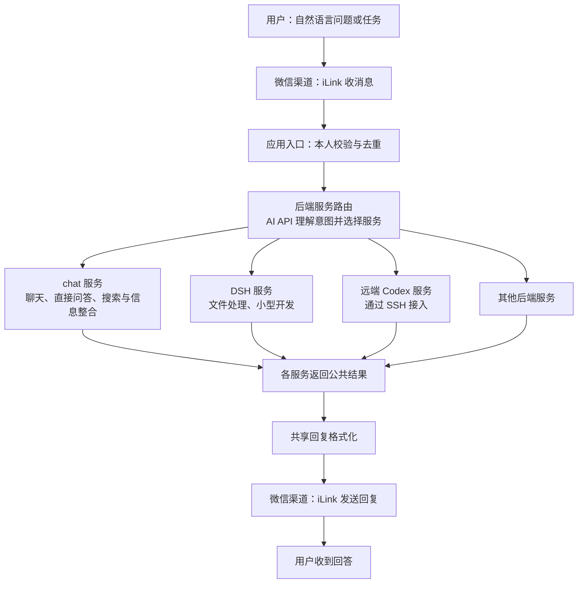

# 多后端微信应用：模块边界草案

> 仓库携带版：2026-10-21，同步原工作区同名文档并调整相对链接。当前实现以源码与 Git 版本为准。

状态：整体模块边界讨论文档。2026-10-21 用户明确确认“自然语言 + AI API 的后端服务路由”及独立的 `chat` 服务边界；chat 已独立实现，实际能力见 [chat L2](../src/chat/L2.md)，上层服务路由与其他后端尚未实现。现存 `wechat-personal-bot` 作为旧实现保留，新重构独立开展；隔离与沿用边界见 [工作须知](工作须知.md)。以下物理目录、接口签名及其他候选细节仍需按实际落地确定。

## 0. 已确认的整体分工

`chat`、DSH、通过 SSH 控制的远端 Codex 是并列的后端服务。“后端服务路由”属于它们的调用管理层，接收自然语言，通过 AI API 判断用户意图并选择服务；人工选服务或固定默认绑定不作为最终路由设计。



### 服务路由与 chat 服务的边界

| 模块 | 决策与工作 | 状态归属 | 不承担 |
|---|---|---|---|
| 后端服务路由 | 将自然语言、可用服务说明和必要的路由上下文交给 AI API；程序校验所选服务并调用对应接口；意图不明确时澄清 | 服务清单、路由上下文、服务绑定和调用状态 | chat 的搜索规划、Search／Fetch 调用、正文和证据管理 |
| chat 服务 | 使用自己的模型调用处理聊天；内部判断直接回答、澄清或执行搜索，管理阅读、查找、补搜、证据核对与回答整合 | chat 对话历史、内部工具循环、来源与证据、搜索预算 | 选择 DSH／远端 Codex 等其他服务，微信协议与实际发送 |
| DSH／远端 Codex 等服务 | 完成对应任务并封装各自协议、运行时与结果 | 各自任务与原生会话状态 | 共享 chat 的内部搜索流程或聊天历史 |

路由 AI 与 chat AI 是不同职责的调用。可选同一供应商甚至同一模型，但请求上下文、提示词、结果契约与状态分开管理；路由器不能通过调用 chat 业务服务来获得自己的意图分类功能。可复用底层 API 客户端，不复用两者的业务流程。

路由 AI 返回的应是受控服务选择和必要的任务信息，由程序验证后执行；不能凭生成文本调用未注册服务。AI 意图识别已确定，具体供应商、模型、输入输出契约、会话绑定与切换规则仍待讨论。不默认把请求广播到全部服务，也不因失败自动换服务重做任务。

此前讨论的搜索链路全部作为 chat 服务内部设计，详见 [chat 服务方案讨论](Weave搜索问答方案讨论.md)。微信渠道、应用入口、路由和共享发送格式化属于外部协作层，不因出现在端到端图中而归入 chat。

## 1. 组织原则

当前首版范围以 [Weave 首版方案](首版方案.md) 为准。本文保留多后端与远程工具控制的候选设计，相关能力按后续阶段接入，不能据此扩大首版实施范围。

先建立可独立测试、可替换的模块边界，以模块化单体作为首版本候选。需要独立部署时，在适配器边界引入进程间通信；独立部署不作为所有模块的初始要求。

- 同一个外部服务的登录、协议、错误处理及生命周期集中在其适配器内。
- 应用层通过自己定义的接口使用服务，不直接依赖 iLink 消息结构、DSH SDK 类型或特定数据库连接。
- 使用构造参数注入依赖，由启动装配入口选择具体实现。
- 接口按当前用途建立，遇到实际能力差异时扩展；不预先要求所有后端支持工具、流式输出或持久会话。
- 新增服务以新增适配器、注册和配置为主要改动；新增业务能力可能需要显式扩展公共契约。

## 2. 模块职责

以下名称表示逻辑边界，具体目录和语言在实施方案中确定。

| 模块 | 负责 | 边界 |
| --- | --- | --- |
| `contracts` | 必要的公共消息、会话标识、执行结果、事件、能力声明及接口 | 保持轻量；无 SDK、数据库或网络实现 |
| `application` | 应用入口的访问、去重和回复协调；通过独立服务路由调用后端 | 只使用契约；不解析外部协议，不持有 chat 搜索业务 |
| 后端服务路由 | AI API 自然语言意图识别、后端服务选择、服务绑定和调用协调 | 位于各并列后端服务之上；不进入 chat 内部工具循环 |
| `channels/ilink` | 授权、凭证、收发协议、游标、渠道专用回复引用及连接恢复 | 不选择 AI 后端，不管理模型历史 |
| `chat` 服务 | 聊天、问答、直接回答／搜索决策、来源阅读与补查、证据与答案整合 | 模型适配器、Search／Fetch 适配器和程序工具属于本服务内部；不路由其他后端 |
| `backends/dsh` | SDK 调用、进程生命周期、会话恢复、事件与错误转换、DSH 专有配置 | 不依赖微信账号字段，不决定其他后端的行为 |
| `backends/<service>` | 对应服务的独立接入和能力映射 | 各后端之间不互相导入；通过共同契约接入 |
| `persistence` | 应用侧记录的具体存取实现和迁移 | 不决定路由，不修改 DSH 等后端的内部存储格式 |
| `bootstrap` | 读取配置、构造实例、注册服务、启动和关闭 | 负责装配，不积累业务规则 |

避免把混合职责搬进公共 `utils`、全局 service 对象或任意键值字典；服务专有辅助代码留在自己的模块内。

## 3. 依赖方向

```text
application ───────────────→ contracts
service router ────────────→ contracts
channels / backends ──────→ contracts
persistence ──────────────→ contracts
bootstrap ────────────────→ 上述各模块（装配）
```

运行时由应用调用注入的适配器。源码上，应用不导入具体适配器；DSH 与 iLink 之间没有直接依赖。

公共边界使用可序列化的数据和稳定标识，避免传播 SDK 实例、进程句柄或数据库连接。将来把某个后端迁到其他进程时，可用远程适配器实现同一应用接口；仍需处理通信、取消、重连与状态恢复。

## 4. 数据和状态所有权

| 状态 | 所有者 |
| --- | --- |
| 微信登录凭证、轮询游标、iLink 回复上下文令牌 | iLink 适配器 |
| 用户与渠道账号身份 | 应用入口与渠道各自负责的身份信息 |
| 服务选择、服务绑定、应用会话与后端会话映射 | 后端服务路由；保存方式按阶段确定 |
| 入站去重记录、执行状态、出站发送状态 | 应用层，通过存储接口保存 |
| chat 历史、搜索循环、正文缓存与证据 | chat 服务；当前目标默认内存保存、重启清空 |
| DSH 原生日志、压缩状态、profile、运行资源 | DSH 运行时，由 DSH 适配器访问 |
| 其他后端的原生会话与资源 | 对应后端，由其适配器访问 |

应用可持有后端会话的不透明标识，但不解析其内容。用户会话与后端绑定应记录后端标识，避免不同服务的同名 session ID 混用。

共享消息记录是否用于跨后端补充上下文、后端切换时继续还是新建会话，尚未决定。公共存储不意味着所有后端可以自动共享记忆。

## 5. 后端能力与消息处理

- 最小调用应表达输入、执行标识和可判定的结果；具体签名在首批后端确定后设计。
- 会话恢复、取消、流式事件、附件及工具授权是可声明能力。应用依据能力选择交互方式，不以 `backend == "dsh"` 散布特殊分支。
- 后端错误在适配器内转换为公共错误类别；专有诊断保留在受控日志中。
- 区分“已接收、执行中、执行结束、回复已发送”。请求超时不能直接推断后端未执行；自动重试、切换后端和重放消息需要独立策略。
- 保持每个会话内的顺序；跨会话并发根据后端和资源能力限定，不强迫所有服务共用一个全局阻塞循环。
- 聊天会话隔离、文件工作目录隔离和工具执行权限分别设计。

## 6. 拆分与替换的验收标准

1. 不安装 DSH 或 iLink 依赖，仍能使用假实现验证应用层用例。
2. 增加第二个实现相同能力契约的后端时，应用核心无需出现服务名称分支，只增加适配器、注册及配置。
3. 升级 DSH SDK 时，改动集中在 DSH 适配器及其测试；协议能力变化通过公共契约明确表达。
4. 将应用侧存储从一种实现换为另一种，不影响渠道和后端调用代码。
5. 替换输入渠道时，后端不需要认识新渠道的原始消息格式。
6. 后续通过导入规则检查约束依赖方向，并以契约测试验证后端能力与语义；本次不生成空目录或测试占位。

## 7. 实施前待定

- 服务路由 AI 的供应商、模型与输入输出契约，以及绑定和切换规则；自然语言 AI 选择服务的方向已确定。
- 会话、消息、附件与执行事件的最小字段。
- 历史归档、跨后端上下文、访问范围与执行权限。
- 首版本语言、目录、存储实现和部署装配方式。

本草案不改变当前旧实现；现有进度和验证以 [交接文档.md](交接文档.md) 为准。
