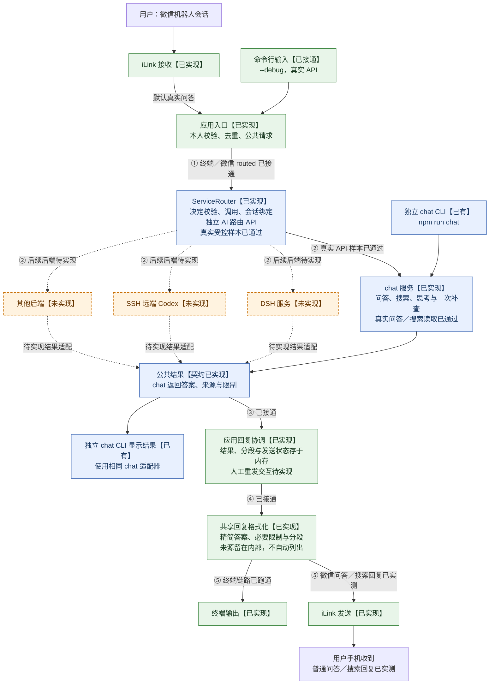

# 多后端微信应用：模块边界草案

> 文档状态核对：2026-10-22。实际实现以源码和模块地图为准，后续候选能力单独标注。

状态：整体模块边界与连接关系说明。chat、服务路由、通用应用回复及终端／微信装配已实现；已通过的样本和未覆盖边界见 [项目交接](交接文档.md#3-验证与已知问题)。实际模块见 [路由 L2](../src/router/L2.md)、[应用 L2](../src/L2.md) 与 [chat L2](../src/chat/L2.md)。DSH、SSH 远端 Codex、持久化模块及相应目录仍为后续候选。旧实现隔离见 [工作须知](工作须知.md)。

## 0. 已确认的整体分工

`chat`、DSH、通过 SSH 控制的远端 Codex 是并列的后端服务。“后端服务路由”属于它们的调用管理层，接收自然语言，通过 AI API 判断用户意图并选择服务；人工选服务或固定默认绑定不作为最终路由设计。

**连接状态标注：2026-10-22，已更新真实 API 联调结果。** 绿色表示已有能力；蓝色表示真实 API 链路的受控样本已通过；橙色表示未实现。实线表示已有连接，虚线待装配或实施。微信真实问答已完成普通问答／搜索回复手机验收，普通启动默认真实服务；--debug 使用终端，早期固定回复诊断已移除。模拟实现与模拟 HTTP／模型测试已删除。①～⑤保留为连接位置编号。



### 当前连接缺口

| 图中编号 | 两端 | 当前状态与剩余工作 |
|---|---|---|
| ① | 应用入口 → 服务路由 | 终端／微信 routed 均已接通，原始文本、应用会话、请求与取消信号贯通。 |
| ② | 服务路由 → chat／其他后端 | 独立路由 API → 真实 ChatService 的问答、追问与搜索读取已实测通过。DSH／远端 Codex 等后端本身尚未实现。 |
| ③ | 后端公共结果 → 路由返回／应用回复协调 | 已接收公共结果，记录后端结果与发送状态，失败不重跑后端；人工恢复／重发交互与持久化未实现。 |
| ④ | 回复协调 → 共享回复格式化 | 答案与限制按 Unicode 分段，隐藏内部引用标记且不自动附全部来源；明确索要的链接保留。复杂排版后续优化。 |
| ⑤ | 共享格式化结果 → iLink／终端渠道 | 终端已跑通；微信 routed 的普通问答、搜索回复已由用户确认收到且格式清爽。普通启动默认真实服务，长回复分段待实机验收。 |

源码核对入口：[启动装配](../src/main.ts)、[应用](../src/application.ts)、[服务装配](../src/service-bootstrap.ts)、[路由](../src/router/L2.md)。**真实路由及 DeepSeek Chat／Search／Fetch 已通过受控样本**；复杂补查、更多意图与异常边界仍需验证，微信普通问答与搜索回复已实测送达，长回复分段和人工重发仍待验收／实施。API 配置入口与调用链路见 [README](../README.md#路由调试与-api-配置)。

### 服务路由与 chat 服务的边界

| 模块 | 决策与工作 | 状态归属 | 不承担 |
|---|---|---|---|
| 后端服务路由 | 将自然语言、可用服务说明和必要的路由上下文交给 AI API；程序校验所选服务并调用对应接口；意图不明确时澄清 | 服务清单、路由上下文、服务绑定和调用状态 | chat 的搜索规划、Search／Fetch 调用、正文和证据管理 |
| chat 服务 | 使用自己的模型调用处理聊天；内部判断直接回答、澄清或执行搜索，管理阅读、查找、补搜、证据核对与回答整合 | chat 对话历史、内部工具循环、来源与证据、搜索预算 | 选择 DSH／远端 Codex 等其他服务，微信协议与实际发送 |
| DSH／远端 Codex 等服务 | 完成对应任务并封装各自协议、运行时与结果 | 各自任务与原生会话状态 | 共享 chat 的内部搜索流程或聊天历史 |

路由 AI 与 chat AI 是不同职责的调用。可选同一供应商甚至同一模型，但请求上下文、提示词、结果契约与状态分开管理；路由器不能通过调用 chat 业务服务来获得自己的意图分类功能。可复用底层 API 客户端，不复用两者的业务流程。

路由 AI 返回受控服务选择，由程序验证后执行；不能调用未注册服务。输入输出、会话绑定与切换的首版契约已实施，见路由 L2；当前 API 装配复用 DeepSeek 底层客户端，路由与 chat 的模型参数独立配置，已通过受控样本，更广泛的意图与任务质量待评估。不默认把请求广播到全部服务，也不因失败自动换服务重做任务。

此前讨论的搜索链路全部作为 chat 服务内部设计，详见 [chat 服务方案讨论](Weave搜索问答方案讨论.md)。微信渠道、应用入口、路由和共享发送格式化属于外部协作层，不因出现在端到端图中而归入 chat。

## 1. 组织原则

当前首版范围以 [Weave 首版方案](首版方案.md) 为准。本文保留多后端与远程工具控制的候选设计，相关能力按后续阶段接入，不能据此扩大首版实施范围。

当前采用单进程的模块化结构，通过接口隔离可独立测试、替换的能力。未来需要独立部署时，再在适配器边界引入进程间通信。

- 同一个外部服务的登录、协议、错误处理及生命周期集中在其适配器内。
- 应用层通过自己定义的接口使用服务，不直接依赖 iLink 消息结构、DSH SDK 类型或特定数据库连接。
- 使用构造参数注入依赖，由启动装配入口选择具体实现。
- 接口按当前用途建立，遇到实际能力差异时扩展；不预先要求所有后端支持工具、流式输出或持久会话。
- 新增服务以新增适配器、注册和配置为主要改动；新增业务能力可能需要显式扩展公共契约。

## 2. 模块职责

下表区分当前实现入口与后续候选职责；当前主干为 TypeScript，准确文件清单由各 L2 维护。

| 模块 | 负责 | 边界 |
| --- | --- | --- |
| [contracts.ts](../src/contracts.ts)／[services.ts](../src/services.ts) | 已实现渠道消息、收发回执、后端请求和结果接口 | 保持轻量；无 SDK、数据库或网络实现；附件与能力声明后续按需扩展 |
| `application` | 应用入口的访问、去重和回复协调；通过独立服务路由调用后端 | 只使用契约；不解析外部协议，不持有 chat 搜索业务 |
| 后端服务路由 | AI API 自然语言意图识别、后端服务选择、服务绑定和调用协调 | 位于各并列后端服务之上；不进入 chat 内部工具循环 |
| [weixin_ilink](../src/weixin_ilink/L2.md) | 已实现登录、凭证、收发协议、游标、渠道专用回复引用及接收重试 | 不选择 AI 后端，不管理模型历史 |
| `chat` 服务 | 聊天、问答、直接回答／搜索决策、来源阅读与补查、证据与答案整合 | 模型适配器、Search／Fetch 适配器和程序工具属于本服务内部；不路由其他后端 |
| `backends/dsh`（候选） | SDK 调用、进程生命周期、会话恢复、事件与错误转换、DSH 专有配置 | 尚未实现；不依赖微信账号字段，不决定其他后端的行为 |
| `backends/<service>`（候选） | 对应服务的独立接入和能力映射 | 尚未实现；各后端通过共同契约接入 |
| `persistence`（候选） | 应用侧持久记录的存取实现和迁移 | 尚未实现；不决定路由，不修改后端内部存储格式 |
| [main.ts](../src/main.ts)／[service-bootstrap.ts](../src/service-bootstrap.ts) | 已实现配置读取、对象构造、服务注册、启动和关闭 | 负责装配，不积累业务规则 |

避免把混合职责搬进公共 `utils`、全局 service 对象或任意键值字典；服务专有辅助代码留在自己的模块内。

## 3. 依赖方向

```text
application ───────────────→ contracts
service router ────────────→ contracts
channels / backends ──────→ contracts
persistence ──────────────→ contracts
bootstrap ────────────────→ 上述各模块（装配）
```

以上表示允许的依赖方向，包含尚未实现的后端与持久化职责。运行时由应用调用注入的适配器，应用不导入具体后端。现有路由与 chat 可分别依赖共享模型适配器；未来 DSH 与 iLink 之间不建立直接依赖。

公共边界使用可序列化的数据和稳定标识，避免传播 SDK 实例、进程句柄或数据库连接。将来把某个后端迁到其他进程时，可用远程适配器实现同一应用接口；仍需处理通信、取消、重连与状态恢复。

## 4. 数据和状态所有权

| 状态 | 所有者 |
| --- | --- |
| 微信登录凭证、轮询游标、iLink 回复上下文令牌 | iLink 适配器 |
| 用户与渠道账号身份 | 应用入口与渠道各自负责的身份信息 |
| 服务选择、服务绑定、应用会话与后端会话映射 | 后端服务路由；当前使用有界内存，重启清空 |
| 入站去重记录、执行状态、出站发送状态 | 应用层；当前使用有界内存，尚无持久化存储接口实现 |
| chat 历史、搜索循环、正文缓存与证据 | chat 服务；当前保存在内存，正文在当前轮结束后释放，历史和结果有容量／时间限制 |
| DSH 原生日志、压缩状态、profile、运行资源（后续） | DSH 运行时，由未来适配器访问 |
| 其他后端的原生会话与资源（后续） | 对应后端，由其适配器访问 |

应用可持有后端会话的不透明标识，但不解析其内容。用户会话与后端绑定应记录后端标识，避免不同服务的同名 session ID 混用。

路由已有按服务绑定会话、继续或新建会话的契约；多后端切换仍需在接入第二个服务后实际验收。是否引入共享消息记录补充跨后端上下文尚未决定，不能由绑定契约推断后端自动共享记忆。

## 5. 后端能力与消息处理

- 当前最小调用为 [BackendService.run(ServiceRequest, AbortSignal)](../src/services.ts)，返回 ServiceResult；请求携带会话／请求标识、文本及可选联网策略。
- 现有取消通过 AbortSignal 传递。新增后端需要会话恢复、流式事件、附件或工具授权时，再扩展能力契约和对应交互，不以 `backend == "dsh"` 散布特殊分支。
- 当前适配器将失败转换为安全错误码和公共结果，不输出供应商原始异常正文；新增诊断须继续遵守凭据与正文保护规则。
- 区分“已接收、执行中、执行结束、回复已发送”。请求超时不能直接推断后端未执行；自动重试、切换后端和重放消息需要独立策略。
- 当前应用按入站消息串行处理，路由和 chat 各有内存并发限制。扩展多用户或多会话时，再制定排队与资源配额，保持同一会话内的顺序。
- 聊天会话隔离、文件工作目录隔离和工具执行权限分别设计。

## 6. 拆分与替换的验收标准

1. 不连接微信，仍能通过终端渠道调试实际路由和后端；按用户要求不保留模拟实现。
2. 增加第二个实现相同能力契约的后端时，应用核心无需出现服务名称分支，只增加适配器、注册及配置。
3. 升级 DSH SDK 时，改动集中在 DSH 适配器及其测试；协议能力变化通过公共契约明确表达。
4. 将应用侧存储从一种实现换为另一种，不影响渠道和后端调用代码。
5. 替换输入渠道时，后端不需要认识新渠道的原始消息格式。
6. 后续通过导入规则检查约束依赖方向，并以契约测试验证后端能力与语义；本次不生成空目录或测试占位。

## 7. 后续扩展待定

- 第二个后端的能力描述、配置、权限、取消／恢复语义及真实切换验收；首版路由供应商、模型配置和会话契约已存在。
- 附件、流式执行事件及能力声明所需的契约扩展；现有文本消息、会话和结果字段继续复用。
- 是否引入跨后端上下文、历史归档或更广访问范围，以及相应的数据和执行权限。
- 确需持久化的状态、SQLite 驱动和恢复语义，以及服务器部署方式；当前语言、目录和本机装配已落地。

这些扩展不改变当前本人专用、内存历史和旧实现隔离的边界；现有进度、已知问题和验证以 [交接文档.md](交接文档.md) 为准。
